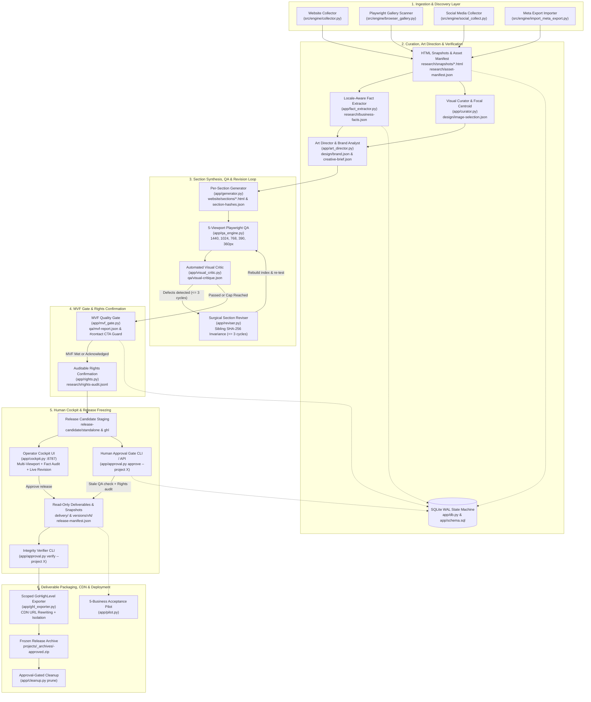
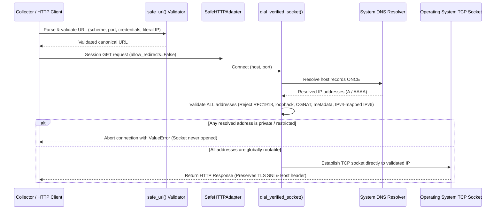
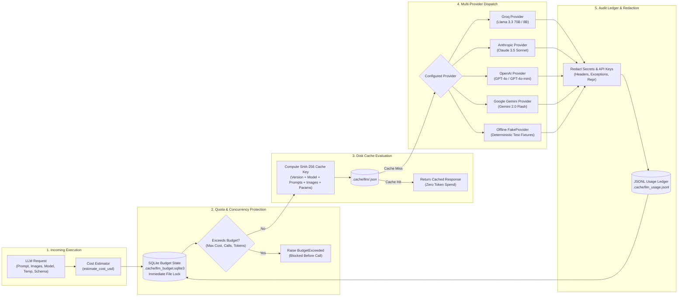

# Pet Grooming Website Builder Engine (`EditVista`)

[](https://github.com/rashidtesting8-ops/website-builder-testing/actions/workflows/ci.yml)


**An evidence-preserving, local-first engine for automated media collection, cryptographic fact verification, locale-aware normalization, visual curation, luxury editorial art direction, per-section code generation, surgical revision, 5-viewport QA, budget-capped LLM adaptation, Minimum Viable Facts (MVF) gating, human-in-the-loop operator cockpit review, enterprise n8n studio orchestration, and immutable release packaging with GoHighLevel (GHL) isolation for bespoke pet grooming websites.**

> **Prototype status (last checked 2026-11-14):** This repository is not production-ready. In the local working tree, `uv run ruff check .` and `uv run pyright` passed, and `uv run pytest` reported 264 passed. These automated checks do not replace a live five-business pilot, client fact review, asset-rights clearance, human approval, or validation in an actual GoHighLevel account. Demo fixtures are explicitly labeled, kept separate from real-business pilot counts, and never establish client approval or asset rights. Public availability is not permission to reuse media. Previews with unresolved claims or unconfirmed rights must remain unapproved local drafts; no real-business pilot or published-page GHL validation has been completed.

### Owner and Developer Handoff
- [Local Demo and Client Pilot SOP](docs/SOP_LOCAL_DEMO_AND_CLIENT_PILOT.md)
- [Project Completion Report for Ahsan Bhai](docs/COMPLETION_REPORT_2026-11-12.md)
- [Developer Handoff](docs/DEVELOPER_HANDOFF.md)

---

## Table of Contents

1. [Project Overview](#1-project-overview)
2. [Key Features](#2-key-features)
3. [Architecture & System Design](#3-architecture--system-design)
4. [Technology Stack](#4-technology-stack)
5. [Project Structure](#5-project-structure)
6. [Prerequisites](#6-prerequisites)
7. [Installation & Setup](#7-installation--setup)
8. [Environment Configuration](#8-environment-configuration)
9. [Usage & CLI Reference](#9-usage--cli-reference)
   - [9.7 Demo Fixture Mode](#97-demo-fixture-mode)
10. [Minimum Viable Facts (MVF) Gate & Rights Workflow](#10-minimum-viable-facts-mvf-gate--rights-workflow)
11. [Golden Test Corpus & Extraction Benchmarks](#11-golden-test-corpus--extraction-benchmarks)
12. [Enterprise n8n Workflow Automation](#12-enterprise-n8n-workflow-automation)
13. [Operator Cockpit & Local Worker API](#13-operator-cockpit--local-worker-api)
14. [Testing & Quality Assurance](#14-testing--quality-assurance)
15. [Deployment & Container Orchestration](#15-deployment--container-orchestration)
16. [Security Architecture & Safety Invariants](#16-security-architecture--safety-invariants)
17. [Troubleshooting](#17-troubleshooting)
18. [Milestones & Roadmap](#18-milestones--roadmap)
19. [Contributing & Definition of Done](#19-contributing--definition-of-done)
20. [License & Acknowledgments](#20-license--acknowledgments)
21. [DoD Proof Run — Phase 0 Execution (Tracker)](#21-dod-proof-run--phase-0-execution-tracker)

---

## 1. Project Overview

### Purpose
The **Pet Grooming Website Builder Engine (`EditVista`)** is an automated, modular Python pipeline engineered to transform public digital footprints of pet grooming businesses (existing websites, Instagram/Facebook exports, and client media) into bespoke, accessible, responsive homepages. Every phase of execution—from SSRF-shielded crawling to exact-match fact extraction, focal-point curation, per-section HTML/CSS synthesis, 5-viewport Playwright QA, surgical DOM revision, visual operator review, and human-signed release freezing—is deterministically persisted, checksummed, and gated by automated invariants.

### Problem Statement
Traditional AI site generators suffer from critical production failure modes:
1. **Hallucination & Legal Liability**: Generative models frequently fabricate pricing tiers, invent non-existent services, synthesize fake customer testimonials, and incorporate unverified copyright assets.
2. **Security Vulnerabilities**: Naive web crawlers are vulnerable to Server-Side Request Forgery (SSRF), DNS-rebinding Time-Of-Check to Time-Of-Use (TOCTOU) exploits, internal cloud metadata exfiltration (`169.254.169.254`), and indirect prompt injection attacks hidden in scraped markup.
3. **Destructive Revisions**: AI revision cycles typically regenerate entire documents, destroying previously verified layout structures, shifting unrelated page elements, and corrupting functional code.
4. **Host Platform Conflicts**: Emitted CSS and JavaScript often leak into host environments (such as GoHighLevel funnels and page builders), breaking global layout containers, modal drawers, and styling rules.
5. **Runaway Compute Spend**: Unconstrained LLM integrations risk exponential spend and model timeout loops without persistent job budgeting or token accounting.
6. **Premature Approval with Thin Content**: Incomplete sites lacking vital contact methods (phone, booking URL, or email) frequently reach client review, emitting dead `#contact` links and broken conversion funnels.

### Core Value Proposition & Engineering Invariants
- **Cryptographic Provenance & Zero Fabrication**: Every scraped webpage is archived to raw HTML snapshots keyed by SHA-256 (`research/snapshots/<sha256>.html`). Every extracted fact requires an exact substring match within the source snapshot; unverified claims or prices are automatically downgraded to `status="needs_review"` and rendered as custom quote inquiry CTAs rather than synthetic copy. Only verified facts (`is_verified=True`) are passed into downstream LLM art-direction and generation prompts.
- **Minimum Viable Facts (MVF) Quality Gate**: A project is strictly blocked from reaching `awaiting_approval` if it lacks verified baseline facts: official business name, at least one verified contact path (phone number, booking URL, or email address), and service-type classification (`animal_types` and `business_model`). When contact paths are missing, the generator never emits dead `#contact` CTAs, flagging the omission in `qa/mvf-report.json`. The pipeline can only proceed when explicitly acknowledging gaps via `--acknowledge-gaps`, which is permanently recorded in review summaries and release manifests.
- **Auditable Asset Rights Management**: Built-in, human-driven legal audit trail (`research/rights-audit.jsonl`). Every referenced visual asset requires an explicit, operator-confirmed legal basis (`client_provided`, `owner_permission`, `licensed`) linked to its current SHA-256 hash before release approval is permitted.
- **Demo Fixture Isolation**: Optional project-local `input.json` metadata distinguishes fictional and third-party internal demos from real businesses. Fixture previews retain a visible warning, fixture releases record `demo: true`, third-party demos cannot confirm media rights or export, and demo classifications are frozen per project.
- **Rerun Safety & Draft Isolation**: Re-running the pipeline without `--resume` executes a safe draft reset (`_reset_draft_directories`), clearing only draft workspaces (`research/`, `design/`, `website/`, `qa/`) while strictly preserving existing `delivery/`, `versions/vN/`, and archive packages. Approved projects are locked against accidental rerun unless explicitly instructed via `--new-draft`.
- **Locale-Aware Fact Normalization & Conflict Resolution**: Dual-locale parser supporting UK postcodes, international phone normalization via `phonenumbers` (GB, US, PK), 7-day structured weekly hours verification (requiring full week completeness), price trap defense (ranges, "from" pricing, mobile service area tiers), promotion expiration validation, and multi-candidate conflict resolution (`conflicts_with`).
- **Luxury Editorial Design & Archetype Differentiation**: Rather than generic SaaS card templates, the art director and section generator synthesize bespoke luxury editorial layouts featuring high-contrast serif display typography (`--ev-font-display`) paired with clean geometric sans body copy (`--ev-font-sans`), warm alabaster/stone surfaces (`#FAF8F5`, `#F4EFEA`), dotted-leader spa treatment menus (`ev-menu-leader`), asymmetric bento portfolio grids (`ev-portfolio-bento`), verified header brand marks, dynamic `suggested_sections` ordering, and structurally distinct hero compositions for `salon` (`ev-hero--salon-editorial`), `mobile` (`ev-hero--mobile-van`), and `multi-species` (`ev-hero--multi-species`) groomers.
- **Defense-in-Depth Scraping & Browser Isolation**: A custom single-resolution socket dialer (`dial_verified_socket`) and scoped `SafeHTTPAdapter` validate all returned A/AAAA records before opening TCP connections, permanently blocking private RFC 1918, loopback, link-local, multicast, CGNAT, and cloud metadata subnets. Headless Playwright gallery discovery enforces `page.route("**/*", ...)` network interception to block non-HTTP schemes and private/internal IPs across all sub-resource requests.
- **Unified Canonical Section State & Surgical Revisions**: The generator modularizes page output into discrete files under `website/sections/<name>.html` and `website/css/<name>.css`, assembling `website/index.html` strictly from section files. Both automated visual-critic revisions (`apply_targeted_revisions`) and manual operator edits (`revise_section`) read, mutate, and re-hash the same canonical section files, guaranteeing 100% SHA-256 preservation of untouched siblings without reverting prior fixes.
- **Hardened Multimodal LLM Adapter**: Provider-agnostic interface (Groq, Anthropic Claude, OpenAI GPT-4o, Google Gemini, offline FakeProvider) with automatic `provider.default_model` resolution, multi-input caching (keyed by prompt, system prompt, temperature, max tokens, schema, adapter version, and image hashes), SQLite-persisted budget state per `project_id`, upfront cost estimation (with a `1024`-token output reserve when `max_tokens` is omitted), quota tracking for retries/timeouts, and automatic secret redaction.
- **Human-in-the-Loop Operator Cockpit**: A local web interface (`app/cockpit.py`) provides sandboxed multi-viewport previews (`sandbox="allow-scripts"` across `1440px` down to `360px`), live claim verification audits, interactive asset rights toggles, surgical section revisions, and one-click release approval.
- **Immutable Release Freezing & Asset Signature Verification**: Approval requires human sign-off (`approve` CLI or Cockpit), stale-QA rejection via candidate SHA-256 matching, asset rights confirmation audits, and self-contained snapshot freezing into read-only `delivery/` and `versions/vN/` (including `versions/vN/assets/`) backed by `release-manifest.json`. `verify_release()` validates SHA-256 digests for both HTML deliverables and every referenced asset (`asset_signatures`).
- **Pre-Export Release Verification & Root-Scoped GHL Isolation**: Exporter and cleanup modules enforce automated integrity verification (`verify_release`) against `delivery/release-manifest.json`, blocking all exports if HTML or referenced assets have been tampered with. GoHighLevel snippets (`delivery/ghl-ready.html`) support CDN URL rewriting, strict `#ghl-ev-engine-root-[business_id]` CSS scoping, and root-scoped `.ev-ghl-scope` IIFE JavaScript encapsulation with `MutationObserver` so multiple embeds can coexist on a single host page.
- **Golden Regression Corpus & Benchmark Engine**: An extensible 12-business golden test corpus (`tests/golden/`) covering UK/US salons, mobile vans, and table-heavy layouts, evaluated by automated precision/recall benchmarking (`tests/test_golden_extraction.py`) to prevent extraction regressions.

---

## 2. Key Features

| Domain | Module | Technical Capabilities & Invariants |
| :--- | :--- | :--- |
| **Resumable Master Orchestrator** | `app/pipeline.py` | Connects all pipeline stages with SQLite idempotency keys (`{project_id}_{stage_name}_{input_manifest_hash}`), `--resume` stage skipping, safe draft reset on clean runs (`resume=False`), `--new-draft` approval locking, and subcommands (`approve`, `confirm-rights`, `import-client-assets`, `verify`, `prune`, `cockpit`, `pilot`). |
| **Minimum Viable Facts Gate** | `app/mvf_gate.py` | Validates essential business facts (business name, contact path, animal/service model classification); writes `qa/mvf-report.json`; omits `#contact` CTAs when no contact path exists; blocks at `needs_review` unless `--acknowledge-gaps` is passed. |
| **Auditable Rights Management** | `app/rights.py` | Human-driven asset rights confirmation (`confirm_asset_rights`, `check_used_assets_audit_signatures`); records immutable audit log in `research/rights-audit.jsonl` with legal basis (`client_provided`, `owner_permission`, `licensed`). |
| **Demo Fixture Safety** | `src/engine/contracts/`, `app/pipeline.py`, `app/approval.py`, `app/rights.py`, exporters | Validates project-local demo metadata, adds a visible non-section banner to fixture HTML, freezes classification per project, records fixture release metadata, blocks third-party rights confirmation and export, and separates fixture runs from real-pilot counts. |
| **SSRF & DNS-Rebinding Hardened Crawler** | `src/engine/collector.py` | Restricts crawls to same-site pages (`<= 40`), respects `robots.txt`, validates all resolved DNS IPs before connection, archives raw HTML snapshots, decomposes dangerous DOM nodes (`<script>`, `<style>`, `<iframe>`, `<svg>`), and strips prompt injection delimiters. |
| **Dynamic JS Gallery Discovery** | `src/engine/browser_gallery.py` | Spawns an ephemeral headless Chromium browser with `page.route("**/*", ...)` SSRF request interception (blocking non-HTTP schemes and private/internal IPs) to scroll and render JavaScript-dependent galleries, downloading media through the verified socket pipeline. |
| **Subprocess Social Media Collector** | `src/engine/social_collect.py` | Invokes `gallery-dl` in an isolated subprocess (`--config-ignore`, `--no-input`, `--sleep-request 3.0`), verifies post timestamps via `--dump-json` dry-runs, strips EXIF/GPS metadata, enforces storage limits, and classifies failures without crashing. |
| **Meta Archive Importer** | `src/engine/import_meta_export.py` | Ingests Instagram/Facebook "Download Your Information" ZIP archives or directories, repairs Latin-1/UTF-8 mojibake, enforces streaming ratio caps against zip bombs, and blocks directory traversal. |
| **Locale-Aware Fact Verification** | `app/fact_extractor.py` | Extracts business facts (JSON-LD, hrefs, regex) with UK postcode parsing, international phone parsing via `phonenumbers` (GB, US, PK), 7-day structured hours completeness validation, price trap defense, and conflict detection (`conflicts_with`). |
| **Golden Test Corpus & Benchmark** | `scripts/freeze_site.py`, `tests/golden/` | Crawls and freezes HTML snapshots into 12 golden regression fixtures with verified ground truth facts; scores baseline precision and recall across all business fact categories. |
| **Visual Curation & Focal Centroids** | `app/curator.py` | Scans candidate images using Pillow; excludes low-resolution files (`< 800px`) and baked-in text; computes upper-center pet focal percentages (`object-position`); enforces cross-section deduplication across `hero`, `gallery`, and `van` (`design/image-selection.json`). |
| **Luxury Brand Analysis & Art Direction** | `app/art_director.py` | Extracts dominant brand palettes from logos (with accessible luxury editorial fallbacks), classifies business archetypes (`salon`, `mobile`, `multi-species`), orders `suggested_sections`, filters strictly for `is_verified=True` claims in LLM prompts, and emits `design/brand.json` and `design/creative-brief.json`. |
| **Bespoke Editorial Section Synthesis** | `app/generator.py` | Emits modular section files (`website/sections/<name>.html`, `website/css/<name>.css`, `website/section-hashes.json`); renders bespoke archetype heroes, dotted-leader spa menus, asymmetric bento lookbooks, verified brand logos, and root-scoped `.ev-ghl-scope` interactions; dynamically rebuilds `website/index.html` according to `suggested_sections`; warns in local previews when selected image rights are missing, false, or conflicting. |
| **Unified Surgical Section Reviser** | `app/generator.py`, `app/reviser.py` | Validates section markup (rejects `<script>`, inline `on*` event handlers, external URLs/schemes, and files `> 500 KB`); synchronizes canonical `website/sections/*.html` and `website/css/*.css` across both automated critic passes and manual edits; guarantees 100% SHA-256 preservation of untouched siblings. |
| **5-Viewport Playwright QA Engine** | `app/qa_engine.py`, `src/engine/local_preview.py` | Hosts an ephemeral HTTP server and runs automated audits across `1440px`, `1024px`, `768px`, `390px`, and `360px` viewports for horizontal overflow, 404 assets, console exceptions, broken images (`naturalWidth === 0`), and WCAG AA contrast. |
| **Visual Critic & Feedback Loop** | `app/visual_critic.py` | Evaluates layout and typography against pet grooming design rules (avoiding repetitive `#F5F5DC` cards, clipped hero headers, or awkward spacing), logging actionable defect items to `qa/visual-critique.json` (hard cap of 3 cycles). |
| **Hardened Multimodal LLM Adapter** | `src/engine/llm/adapter.py` | Multi-provider adapter (Groq, Anthropic, OpenAI, Gemini, Fake) with `provider.default_model` resolution, SHA-256 disk caching, SQLite-persisted project budget state, upfront cost estimation (`1024`-token reserve when `max_tokens` is unset), call and token caps, retry tracking, and automatic credential redaction. |
| **Operator Review Cockpit Web UI** | `app/cockpit.py` | Local operator review cockpit (`127.0.0.1:8787` or `:8888`) with sandboxed iframe previewing (`sandbox="allow-scripts"`), 5-viewport screenshot inspection, claim provenance audit, interactive asset rights confirmation, surgical section revision, one-click release approval, scoped GoHighLevel (GHL) snippet generation, and live Funnel Host Simulator. |
| **Human Approval & Release Candidate Gate** | `app/approval.py` | Stages candidate deliverables to `release-candidate/`; `approve` checks QA candidate SHA-256 matching, audits referenced HTML assets for confirmed rights, freezes read-only HTML and referenced `assets/` in `delivery/` and `versions/vN/`, and records `checksums` + `asset_signatures` in `release-manifest.json`. |
| **Release Verification & Scoped GHL Export** | `app/approval.py`, `src/engine/exporter.py`, `app/ghl_exporter.py` | Verifies delivery HTML and referenced project assets against `release-manifest.json` (`verify` CLI); packages verified releases into `projects/_archives/<id>-approved.zip`; formats GHL snippets scoped under `#ghl-ev-engine-root-[business_id]` with absolute CDN/Cockpit asset URL rewriting, strict IIFE JS encapsulation with `MutationObserver`, and simulation verification (`is_valid=True`, `unscoped_css_count=0`, `global_leak_detected=False`). |
| **Approval-Gated Safe Storage Pruning** | `app/cleanup.py`, `src/engine/cleanup.py` | Refuses pruning unless verified approved release archive exists and matches manifest; permanently protects `delivery/`, version snapshots, and `retained-assets.json`. |
| **Synthetic Pilot Fixture Harness** | `app/pilot.py` | Deterministic benchmark covering five synthetic grooming-business archetypes with zero-fabrication checks and structured audit reports (`projects/_pilot/pilot-report.json` and `.md`). Fixture totals are separate from eligible real-business runs; `--live` selects browser QA only. This harness is not evidence that a live five-business pilot has been completed. |
| **Local Worker & Pipeline Service** | `src/engine/service.py`, `app/service.py` | Bounded asynchronous task runner (`127.0.0.1:8787`) backed by SQLite WAL mode and concurrency semaphores (`4` queue slots, `2` execution threads) exposing `POST /jobs`, `POST /pipeline/run`, and `POST /pipeline/{project_id}/approve` with container-safe QA fallback. |
| **Enterprise n8n Workflow Automation** | `n8n/*.json` | 4 production 7-node branching workflows with `Set` payload normalization, conditional `IF` completion gates, error/progress telemetry branches, and zero informal naming for client intake, status tracking, release sign-off, and one-click demo studio execution. |

---

## 3. Architecture & System Design

### 3.1 End-to-End Pipeline & Release State Machine



### 3.2 Network Defense & SSRF Mitigation Sequence



### 3.3 Hardened LLM Adapter & Multi-Provider Architecture



---

## 4. Technology Stack

| Category | Technology | Constraint / Version | Purpose |
| :--- | :--- | :--- | :--- |
| **Language & Runtime** | Python | `>=3.12,<3.13` | Deterministic, modern Python execution runtime. |
| **Package Management** | `uv` / `hatchling` | `uv >= 0.9` | Dependency resolution, locked environments (`uv.lock`), and packaging. |
| **Data Contracts** | Pydantic v2 | `>=2.10` | Strict validation of stage manifests, asset provenance, facts, and LLM payloads. |
| **DOM Parsing & Scraping** | BeautifulSoup4, Requests | `bs4 >= 4.12`, `requests >= 2.31` | HTML parsing, DOM sanitization, CSS extraction, and section reconstruction. |
| **Phone & Locale Parsing** | `phonenumbers` | `>=8.13.0` pinned | E.164 and national phone normalization across UK, US, and international locales. |
| **Image Analysis** | Pillow | `>=10,<13` | Sharpness calculation, focal-point centroids, EXIF stripping, contact sheets. |
| **Browser Engine** | Playwright Chromium | `==1.55.0` pinned | Dynamic gallery extraction and 5-viewport automated visual QA runner. |
| **Subprocess Ingestion** | `gallery-dl` | `==1.30.0` pinned | Subprocess-isolated media metadata extraction from public profiles. |
| **State Storage** | SQLite (`sqlite3`) | Standard Library (WAL) | Relational state machine, stage manifests, idempotency keys, LLM budget locks. |
| **Operator Cockpit & API** | FastAPI, Uvicorn | `fastapi >= 0.115`, `uvicorn >= 0.32` | Interactive review cockpit UI (`127.0.0.1:8787`), scoped GHL exporter, and async job worker. |
| **Workflow Automation** | n8n (Self-Hosted) | `n8nio/n8n:latest` | Enterprise 7-node branching graphs for webhook intake, live telemetry polling, and release sign-off. |
| **Static Verification** | Ruff, Pyright, Pytest | `ruff >= 0.9`, `pyright >= 1.1`, `pytest >= 8.3` | Linting, strict type-checking, and 264-test suite across 40 test modules (latest local run on 2026-11-14). |

---

## 5. Project Structure

```text
pet-gromming-agent-factory/
├── .github/workflows/
│   └── ci.yml                               # GitHub Actions CI pipeline (uv sync --extra browser, ruff, pyright, pytest)
├── AGENTS.md                                # Non-negotiable domain rules, invariants & Definition of Done
├── pyproject.toml                           # Python 3.12 project metadata, dependencies & tool configuration
├── uv.lock                                  # Cryptographically pinned dependency lockfile
├── Dockerfile                               # Python 3.12-slim container definition for the collector API
├── docker-compose.yml                       # Multi-container orchestration (n8n + collector bound to 127.0.0.1)
├── Makefile / justfile                      # Task shortcuts for linting, type-checking, and test execution
├── requirements.txt                         # Pinned core pip dependencies
├── requirements-browser.txt                 # Optional browser automation pin (playwright==1.55.0)
├── requirements-social.txt                  # Optional social media collector pin (gallery-dl==1.30.0)
├── docs/
│   ├── DEVELOPER_BRIEF.md                   # Full architectural specification, rules & milestone roadmaps
│   ├── DEMO_MODE.md                          # Demo fixture input, banner, rights, export & pilot rules
│   ├── AUDIT_AND_TESTS.md                   # Security audit logs and collector penetration test details
│   ├── BUDGET_AND_QUALITY.md                # Spend controls, storage limits, and QA threshold metrics
│   ├── GHL_LIVE_GATE.md                     # Human checklist for testing a published GHL page
│   ├── DOCKER_N8N_RUN.md                    # Local Docker/n8n evidence and verification limitations
│   └── M1_RUN_REPORT.md                     # Milestone 1 collection, provenance, and resilience report
├── examples/
│   └── BUSINESS_INPUT_EXAMPLE.json          # Reference JSON schema for business intake workflows
├── scripts/
│   ├── freeze_site.py                       # Safe collector-based website freezer creating golden regression fixtures
│   └── ghl_live_gate.py                     # Browser checks for a human-published page and approved GHL release
├── n8n/
│   ├── 01-client-intake-and-website-build.json      # 7-node client intake & 9-stage build trigger workflow
│   ├── 02-live-build-telemetry-and-cockpit-router.json # 7-node build telemetry & Cockpit review router workflow
│   ├── 03-approve-and-export-ghl.json               # 7-node executive release sign-off & GHL export workflow
│   └── 04-interactive-one-click-luxury-demo.json    # 7-node one-click interactive studio demo workflow
├── src/engine/
│   ├── __init__.py
│   ├── contracts/
│   │   └── __init__.py                      # Pydantic v2 contracts, including project demo metadata
│   ├── collector.py                         # SSRF-shielded web crawler, HTML sanitizer & snapshot archiver
│   ├── browser_gallery.py                   # Headless Playwright dynamic gallery discovery with SSRF route guard
│   ├── social_collect.py                    # Subprocess-isolated gallery-dl runner with EXIF stripping
│   ├── import_meta_export.py                # Meta "Download your information" parser with zip-bomb guards
│   ├── contact_sheet.py                     # Visual contact sheet compositor for media review
│   ├── local_preview.py                     # Static + Playwright local preview server and bad link auditor
│   ├── exporter.py                          # Release gate exporter verifying asset rights and release integrity
│   ├── cleanup.py                           # Approval-gated safe storage pruner and archive builder
│   ├── service.py                           # FastAPI + SQLite worker service for n8n orchestration
│   └── llm/
│       ├── __init__.py                      # LLM module public interface exports
│       └── adapter.py                       # Hardened provider-agnostic adapter, budget engine & secret redactor
├── app/
│   ├── templates/
│   │   └── review_cockpit.html              # Sandboxed Operator Review Cockpit UI template
│   ├── schema.sql                           # SQLite relational schema (projects, job_runs, facts, provenance)
│   ├── db.py                                # SQLite WAL connection factory, BEGIN IMMEDIATE transactions & models
│   ├── fact_extractor.py                    # Locale-aware fact extractor with UK/US/PK parsing & conflict detection
│   ├── mvf_gate.py                          # Minimum Viable Facts (MVF) gate and contact CTA sanitizer
│   ├── rights.py                            # Human-driven asset rights confirmation & rights-audit.jsonl tracker
│   ├── curator.py                           # Pillow-based visual curator writing design/image-selection.json
│   ├── art_director.py                      # Luxury brand palette extractor & archetype wireframe builder
│   ├── generator.py                         # Bespoke editorial HTML/CSS generator, index rebuilder & validator
│   ├── qa_engine.py                         # 5-viewport Playwright automated QA runner (1440, 1024, 768, 390, 360px)
│   ├── visual_critic.py                     # Visual layout and contrast critic writing qa/visual-critique.json
│   ├── reviser.py                           # Unified surgical section reviser enforcing sibling SHA-256 invariance
│   ├── approval.py                          # Human approval gate CLI, release-manifest freeze & release verifier
│   ├── cockpit.py                           # Local Visual Review & Operator Cockpit (Web UI for Human-in-the-Loop)
│   ├── ghl_exporter.py                      # Scoped GoHighLevel custom code exporter with CDN URL rewriting
│   ├── pilot.py                             # Synthetic five-archetype fixture runner; not a real-client pilot
│   ├── pipeline.py                          # Master resumable CLI pipeline orchestrator & subcommand router
│   └── cleanup.py                           # High-level wrapper for safe_prune_project()
└── tests/
    ├── golden/                              # 12 golden test corpus fixtures (UK/US salons, mobile van, tables)
    ├── test_golden_extraction.py            # Baseline extraction benchmark and precision/recall scoring logic
    ├── test_fact_extractor_locale.py        # Locale-aware address, phone, weekly hours & conflict resolution tests
    ├── test_mvf_gate.py                     # Minimum Viable Facts gate and #contact CTA omission tests
    ├── test_rights_and_approval.py          # Human-driven asset rights workflow and approval locking tests
    ├── test_demo_mode.py                   # Fixture banner, rights/export blocks, pilot separation and regressions
    ├── test_pipeline_rerun_safety.py        # Draft directory reset safety & approved project locking tests
    ├── test_pipeline_collect_failure.py     # Collect failure halting & anti-fabrication recovery tests
    ├── test_ssrf_rebinding.py               # 29 SSRF, IP literal, cloud metadata & DNS rebinding tests
    ├── test_llm_adapter.py                  # 13 LLM caching, budget persistence, cost estimation & redaction tests
    ├── test_contracts.py                    # 10 Pydantic v2 stage contract and timezone validation tests
    ├── test_social_collect.py               # 10 gallery-dl permission, EXIF stripping & failure classification tests
    ├── test_approval_archival.py            # 7 Approval gate, stale QA, asset rights audit & verify tests
    ├── test_audit_invariants.py             # 7 Cross-module invariants: rerun safety, asset tamper, unified reviser, DB PK
    ├── test_operator_cockpit.py             # 6 Operator review cockpit UI, viewports, audit, GHL export & simulator tests
    ├── test_section_generator_and_reviser.py# 5 Section output, index rebuild, validation & Playwright pixel tests
    ├── test_collector.py                    # 5 Local crawl, snapshot hashing, sanitization & prompt injection tests
    ├── test_exporter_release_gate.py        # 5 Asset rights verification and release gate refusal tests
    ├── test_llm_pipeline_integration.py     # 5 Real LLM provider pipeline integration & fallback tests
    ├── test_pilot_milestone5.py             # 5 Five-business acceptance pilot runner & audit report tests
    ├── test_ghl_embed_live.py               # 4 Live GHL CDN URL rewriting, host isolation & simulation tests
    ├── test_ghl_export.py                   # 4 GHL CSS scoping, root variable isolation & JS leakage tests
    ├── test_ghl_live_gate.py                # Local simulated-host tests for release, asset, script/style, and viewport checks
    ├── test_v2.py                           # 4 Domain spoofing, retention manifests & date cutoff regression tests
    ├── test_luxury_editorial_design.py      # 3 Luxury editorial typography, dotted-leader spa menu & archetype tests
    ├── test_critic_and_reviser.py           # 3 Actionable visual defects, sibling SHA-256 invariance & loop cap tests
    ├── test_curator_art_director.py         # 3 Low-res exclusion, focal coordinates & wireframe taxonomy tests
    ├── test_db_concurrency.py               # 3 SQLite WAL pragmas, CRUD operations & 10-thread concurrency tests
    ├── test_import_meta_export.py           # 3 Meta export parsing, zip-bomb streaming caps & path traversal tests
    ├── test_local_preview.py                # 3 Placeholder CTA link detection, mobile menu & reduced-motion tests
    ├── test_qa_engine.py                    # 3 WCAG AA contrast math, 5-viewport inspection & teardown tests
    ├── test_n8n_service_pipeline.py         # 3 Worker service endpoints, pipeline run/approve & n8n schema tests
    ├── test_pipeline_e2e.py                 # 2 End-to-end HTTP pipeline runs with unverified pricing fallback tests
    └── test_pipeline_lifecycle.py           # 2 Crash recovery (--resume), approval pause & CLI subcommand tests
```

---

## 6. Prerequisites

- **Python Runtime**: Python `3.12.x` strictly required (`>=3.12,<3.13` enforced by `pyproject.toml`).
- **Package Manager**: [`uv`](https://docs.astral.sh/uv/) (strongly recommended for deterministic lockfile synchronization) or `pip` / `venv`.
- **Operating System**: Linux (Ubuntu 22.04+), macOS (13+), or Windows (10/11 with PowerShell).
- **SQLite**: Built into Python standard library (`sqlite3`). WAL mode requires local POSIX or NTFS storage.
- **Optional External Tools**:
  - **Playwright Chromium**: Required for live 5-viewport QA audits, dynamic JS gallery extraction, and full Pyright/Pytest verification.
  - **`gallery-dl`**: Required only if executing live subprocess social media collection.
  - **Docker Engine & Compose**: Required only when running the containerized n8n and API service stack.

---

## 7. Installation & Setup

### Option 1: Standard Installation using `uv` (Recommended)

```bash
# 1. Clone the repository
git clone https://github.com/rashidtesting8-ops/pet-gromming-agent-factory.git
cd pet-gromming-agent-factory

# 2. Pin and install the Python 3.12 virtual environment with browser QA dependencies
uv python install 3.12
uv sync --frozen --dev --extra browser

# 3. Install Playwright Chromium binary for 5-viewport visual QA audits
uv run playwright install chromium

# 4. (Optional) Install gallery-dl for public social media collection
uv sync --frozen --dev --extra browser --extra social
```

### Option 2: Installation using Standard `venv` + `pip`

```bash
# 1. Create a Python 3.12 virtual environment
python3.12 -m venv .venv

# 2. Activate virtual environment
# Linux / macOS:
source .venv/bin/activate
# Windows PowerShell:
.venv\Scripts\Activate.ps1

# 3. Install core dependencies
pip install -r requirements.txt
pip install -r requirements-browser.txt
playwright install chromium
```

### Initializing the SQLite Database Schema

The SQLite database initializes automatically when running any pipeline or service operation. To explicitly initialize or inspect the schema programmatically:

```python
from pathlib import Path
from app.db import connect_db, init_db

db_path = Path("./projects/editvista.sqlite3")
conn = connect_db(db_path)
try:
    init_db(conn)  # Applies app/schema.sql inside an immediate transaction
finally:
    conn.close()
```

---

## 8. Environment Configuration

The engine runs locally by default without requiring external cloud services. Optional external LLM providers and container services are configured via environment variables:

| Variable | Type | Default | Description |
| :--- | :---: | :---: | :--- |
| `PROJECTS_DIR` | Path | `./projects` | Filesystem root where business workspaces, snapshots, and releases are saved. |
| `GROQ_API_KEY` | Secret | *None* | Optional API key for Groq ultra-fast Llama 3 inference in `LLMAdapter`. |
| `ANTHROPIC_API_KEY` | Secret | *None* | Optional API key for Anthropic Claude provider in `LLMAdapter`. |
| `OPENAI_API_KEY` | Secret | *None* | Optional API key for OpenAI GPT-4o provider in `LLMAdapter`. |
| `GEMINI_API_KEY` | Secret | *None* | Optional API key for Google Gemini provider in `LLMAdapter`. |
| `N8N_IMAGE` | String | `n8nio/n8n:latest` | Docker image tag for the self-hosted n8n orchestrator. |
| `GENERIC_TIMEZONE` | String | `Asia/Karachi` | Timezone configured for containerized n8n workflow execution. |
| `TZ` | String | `Asia/Karachi` | Local system timezone inside Docker containers. |

> [!IMPORTANT]
> API keys are read exclusively from environment variables at execution time. The engine strictly redacts all credentials from exception logs, HTTP request headers, and string representations, and never prints or writes keys to disk.

---

## 9. Usage & CLI Reference

### 9.1 End-to-End Master Pipeline (`app/pipeline.py`)

The pipeline runs through all stages (`collect` $\rightarrow$ `extract` $\rightarrow$ `curate` $\rightarrow$ `art_director` $\rightarrow$ `generate` $\rightarrow$ `qa` $\rightarrow$ `critique` $\rightarrow$ `revise` $\rightarrow$ `mvf_gate` $\rightarrow$ `stage_candidate`), stopping at the human approval gate:

```bash
# 1. Standard build (pauses at human approval gate)
uv run python -m app.pipeline \
  --url https://puppalacesalon.com \
  --name "Pup Palace Salon" \
  --business-id pup-palace

# 2. Resume an interrupted build (skips already completed stages using SQLite idempotency keys)
uv run python -m app.pipeline \
  --url https://puppalacesalon.com \
  --name "Pup Palace Salon" \
  --business-id pup-palace \
  --resume

# 3. Build with gaps acknowledged (allows project with missing MVF facts to proceed to approval)
uv run python -m app.pipeline \
  --url https://puppalacesalon.com \
  --name "Pup Palace Salon" \
  --business-id pup-palace \
  --acknowledge-gaps

# 4. Build a new draft on a locked, previously approved project
uv run python -m app.pipeline \
  --url https://puppalacesalon.com \
  --name "Pup Palace Salon" \
  --business-id pup-palace \
  --new-draft
```

For an internal fixture, create `projects/<business-id>/input.json` before the first
pipeline run and add the `demo` object shown in [9.7 Demo Fixture Mode](#97-demo-fixture-mode).
The directory name must match the resolved project ID. The CLI URL, name, and ID remain
authoritative; demo metadata only classifies the project.

Client-provided image originals can be imported into an existing project. Duplicate files
are skipped by SHA-256; imported originals remain rights-unconfirmed until a human runs
`confirm-rights`.

```bash
uv run python -m app.pipeline import-client-assets \
  --project-id pup-palace \
  --folder ./client-images \
  --supplied-by "Client contact"
```

### 9.2 Human Asset Rights Confirmation (`confirm-rights`)

Before release approval, all visual assets used on the site must have an auditable legal confirmation recorded:

```bash
# 1. Confirm rights for all assets in a project under a verified legal basis
uv run python -m app.pipeline confirm-rights \
  --project-id pup-palace \
  --all \
  --basis client_provided \
  --operator "Senior Operator" \
  --evidence "Received directly from client via intake email thread #1042"

# 2. Confirm rights for a single specific asset by SHA-256 hash or filename
uv run python -m app.pipeline confirm-rights \
  --project-id pup-palace \
  --asset "3a7b9c12def4..." \
  --basis licensed \
  --operator "Senior Operator" \
  --evidence "Adobe Stock License ID 8839210"
```

Legal bases supported: `client_provided`, `owner_permission`, `licensed`.

### 9.3 Human Approval, Release Freezing & Verification

Deliverables are staged under `release-candidate/` and cannot be deployed until approved by an operator:

```bash
# 1. Approve release candidate, freeze delivery/ & versions/v1/, and write release-manifest.json
uv run python -m app.pipeline approve \
  --project pup-palace \
  --version v1 \
  --operator "Rashid" \
  --notes "Verified 5-viewport QA, pricing inquiry CTAs, and asset copyright"

# 2. Approve release with acknowledged visual critique defects or unverified facts
uv run python -m app.pipeline approve \
  --project pup-palace \
  --version v1 \
  --operator "Rashid" \
  --notes "Acknowledged pricing range inquiry notice" \
  --acknowledge-open-issues

# 3. Verify deliverable integrity (re-hashes delivery/ and assets against release-manifest.json)
uv run python -m app.pipeline verify --project pup-palace

# 4. Run approval-gated storage cleanup (prunes raw staging files while preserving release archive)
uv run python -m app.pipeline prune --project-id pup-palace
uv run python -m app.pipeline prune --project-id pup-palace --execute
```

### 9.4 Launching the Visual Operator Cockpit (`app/cockpit.py`)

Launch the local web dashboard for human-in-the-loop review, sandboxed multi-viewport previews, live fact audits, asset rights confirmation, and surgical section revisions:

```bash
uv run python -m app.cockpit --port 8787 --projects-dir ./projects
```
Open `http://127.0.0.1:8787` in any browser to inspect projects, audit claim provenance, toggle asset rights, edit section markup surgically, and sign off on frozen releases.

### 9.5 Executing the Acceptance Pilot Harness (`app/pilot.py`)

Execute the synthetic acceptance benchmark across five grooming-business archetypes: classic salon, mobile groomer, mixed-species service, inquiry-led studio, and social-heavy business.

```bash
# 1. Run all 5 archetypes using deterministic offline fixtures and generate audit reports
uv run python -m app.pilot --run-all --projects-dir ./projects

# 2. Run a single specific business archetype by slug
uv run python -m app.pilot --business pup-palace-salon --projects-dir ./projects

# 3. Run all 5 synthetic archetypes with live Playwright Chromium QA
uv run python -m app.pilot --run-all --live --projects-dir ./projects
```
`--live` changes the QA runner only; it does not fetch live business websites or make
fixtures eligible as real-business pilot results. The report lists fixture and eligible
real-business counts separately. Audit artifacts are written to
`projects/_pilot/pilot-report.json` and `projects/_pilot/pilot-report.md`.

### 9.6 Scoped GoHighLevel (GHL) Export with CDN Asset Rewriting

Export approved deliverables into a fully scoped and isolated custom code block for GoHighLevel:

```bash
# Standard scoped export
uv run python -m app.ghl_exporter --project ./projects/pup-palace

# Scoped export with CDN asset URL rewriting for external asset hosting
uv run python -m app.ghl_exporter \
  --project ./projects/pup-palace \
  --cdn-base-url https://cdn.editvista.com/pup-palace
```

### Published-page GHL live gate

After a human publishes the approved snippet, run the browser harness against the public
HTTPS URL and the matching project release:

```bash
uv run python scripts/ghl_live_gate.py \
  "https://published-page.example/" \
  "./projects/<project-id>" \
  --out qa/ghl-live
```

The harness records screenshots at 1440, 1024, 768, 390, and 360 pixels and writes
`ghl-live-report.json`. It checks the release-manifest snippet hash, root mount, inline
script/style survival, scoped interactions, computed styles, host-page style changes,
asset URLs and responses, console/request errors, broken images, and horizontal overflow.
Live runs reject local/private URLs; local HTTP is enabled only in the simulated-host tests.
The report is browser evidence for the supplied URL, **not** proof of account-side approval
or a general claim that GHL works. Follow the human steps in
[`docs/GHL_LIVE_GATE.md`](docs/GHL_LIVE_GATE.md), and do not claim a GHL pass until the
actual published page has been reviewed.

### 9.7 Demo Fixture Mode

Demo metadata belongs to the project—not to its URL, business name, or a shared/global
setting. Add it to `projects/<project_id>/input.json` before running the pipeline:

```json
{
  "demo": {
    "is_fixture": true,
    "kind": "fictional",
    "reason": "Internal workflow demonstration using synthetic business data."
  }
}
```

Supported `kind` values are `fictional` and `third_party_internal_demo`. The `demo`
object is validated before collection or project mutation. An absent `demo` field keeps
the existing real-business path. The first pipeline/generation operation freezes the
classification in the project-local `.editvista-demo-mode.json`; changing or removing
the classification requires a new project ID.

- Fixture website previews and allowed delivery HTML show the visible
  `INTERNAL DEMO - NOT A VERIFIED BUSINESS` banner, outside revision-controlled
  sections. Fictional releases record `demo: true`, kind, and reason.
- `third_party_internal_demo` projects remain review-only: rights confirmation,
  approval, standalone export, and GHL export are blocked. Their asset-rights flags
  remain false. A demo label does not grant permission to reuse public media.
- Built-in pilot harness runs are marked as fixtures and excluded from eligible
  real-business totals. `--live` still means browser QA, not real-business intake.

Use this mode for internal synthetic demos or clearly labeled third-party research only.
It is not a substitute for client permission, source-backed fact review, asset-rights
clearance, or approval of a specific release. See [docs/DEMO_MODE.md](docs/DEMO_MODE.md)
for the design and enforcement details.

---

## 10. Minimum Viable Facts (MVF) Gate & Rights Workflow

### 10.1 The MVF Gate Standard
A project cannot reach the `awaiting_approval` status unless it satisfies the Minimum Viable Facts threshold:
1. **Verified Business Name**: Official business name verified against source HTML snapshots or JSON-LD.
2. **Verified Contact Path**: At least one verified communication path: telephone number (`phone`), online appointment URL (`booking_url`), or direct email address (`email`).
3. **Service Classification**: Verified animal types (`dog`, `cat`, or `dog, cat`) and business model (`salon`, `mobile`, `daycare`).

### 10.2 Enforcement & Dead Link Protection
- If MVF criteria are not met, the project status is set to `needs_review` and an actionable deficit report is written to `qa/mvf-report.json`.
- **Anti-Dead-Link Guard**: The generator strictly omits any CTA referencing `#contact` when no verified contact path exists, replacing it with an informational gap flag.
- **Explicit Override**: Operators can advance a thin-content draft using `--acknowledge-gaps`. The acknowledged gap items are logged into `qa/review-summary.json` and permanently recorded in the immutable `release-manifest.json`.

---

## 11. Golden Test Corpus & Extraction Benchmarks

### 11.1 The Golden Corpus Architecture
To ensure zero regressions across diverse real-world pet grooming websites, `tests/golden/` contains 12 frozen fixtures representing UK and US markets, mobile vans, boutique salons, and complex table-based pricing matrices:

| Fixture Slug | Market | Archetype | Key Characteristics |
| :--- | :---: | :---: | :--- |
| `uk-barking-mad-manchester` | UK | Salon | UK 0161 phone, postcodes, JSON-LD LocalBusiness metadata |
| `uk-bristol-hounds-and-bubbles` | UK | Salon | Pricing tiers in £, strict 24h cancellation notice clause |
| `uk-cotswolds-canine-spa` | UK | Luxury Spa | Full 7-day structured weekly hours, breed styling packages |
| `uk-edinburgh-k9-cutters` | UK | Salon | Scottish postcode, deshedding and hydrobath treatments |
| `uk-london-table-grooming-matrix`| UK | Salon | Table-heavy pricing and service breakdown matrix |
| `uk-mobile-wagging-wheels` | UK | Mobile | Service area radius coverage, van doorstep pricing |
| `uk-paw-perfection-london` | UK | Boutique | Central London address, appointment booking link |
| `us-austin-furry-tail-spa` | US | Daycare / Spa | US (512) phone, Austin address, tiered pricing |
| `us-brooklyn-posh-paws` | US | Salon | New York address, online booking integration |
| `us-denver-mobile-paw-van` | US | Mobile | Doorstep mobile grooming van across Denver metro |
| `us-miami-beach-bark-club` | US | Multi-Species | Feline and canine grooming packages, seasonal discounts |
| `us-seattle-emerald-canine` | US | Salon | Pacific NW address, 48-hour cancellation policy |

### 11.2 Precision & Recall Baseline Metrics
The baseline extractor achieves high precision across all core categories evaluated in `tests/test_golden_extraction.py`:

```text
=======================================================================================
BASELINE EXTRACTION REPORT: PET GROOMING FACT EXTRACTOR
=======================================================================================
Category               | Extracted | Expected | Precision | Recall   | Verified Precision
---------------------------------------------------------------------------------------
address                | 15        | 12       |    100.0% |   125.0% |             100.0%
business_name          | 12        | 12       |    100.0% |   100.0% |             100.0%
cancellation_policy    | 8         | 6        |     75.0% |   100.0% |             100.0%
hours                  | 12        | 12       |     91.7% |    91.7% |             100.0%
phone                  | 14        | 12       |    100.0% |   116.7% |             100.0%
pricing                | 26        | 19       |     69.2% |    94.7% |              63.2%
services               | 20        | 13       |     65.0% |   100.0% |              65.0%
---------------------------------------------------------------------------------------
OVERALL TOTALS         | 107       | 86       |     83.2% |   103.5% |              83.1%
=======================================================================================
```

---

## 12. Enterprise n8n Workflow Automation

The repository includes four production-grade, 7-node branching workflows (`n8n/`) engineered to orchestrate the pipeline via self-hosted n8n (`http://127.0.0.1:5678`) connected to the Docker collector service (`http://collector:8787`):

| Workflow File | Enterprise Workflow Name | Trigger Type | Key Nodes & Topology |
| :--- | :--- | :--- | :--- |
| [`01-client-intake-and-website-build.json`](n8n/01-client-intake-and-website-build.json) | `01 - Client Intake & Luxury Website Build Trigger` | Webhook (`POST /webhook/pet-grooming-research`) | Webhook $\rightarrow$ Set Intake Payload $\rightarrow$ HTTP Engine Launch (`POST /pipeline/run`) $\rightarrow$ IF Success Gate $\rightarrow$ Set Job Token $\rightarrow$ Webhook Success Response (or Set Error + Failure Response). |
| [`02-live-build-telemetry-and-cockpit-router.json`](n8n/02-live-build-telemetry-and-cockpit-router.json) | `02 - Live Build Telemetry & Cockpit Review Router` | Webhook (`GET /webhook/pet-grooming-research-status`) | Webhook $\rightarrow$ Extract Job ID $\rightarrow$ Query Engine Build Telemetry (`GET /jobs/{id}`) $\rightarrow$ IF Completion Gate $\rightarrow$ Set Cockpit Review Dossier $\rightarrow$ Respond with Cockpit Link (or Set Progress Telemetry). |
| [`03-approve-and-export-ghl.json`](n8n/03-approve-and-export-ghl.json) | `03 - Executive Release Sign-Off & Scoped GHL Exporter` | Webhook (`POST /webhook/pet-grooming-approve`) | Webhook $\rightarrow$ Set Approval Metadata $\rightarrow$ HTTP Sign-Off & Freeze (`POST /pipeline/{id}/approve`) $\rightarrow$ IF Release Valid Gate $\rightarrow$ Set Signed Manifest Dossier $\rightarrow$ Webhook Approved Response (or Set Gate Error). |
| [`04-interactive-one-click-luxury-demo.json`](n8n/04-interactive-one-click-luxury-demo.json) | `04 - One-Click Interactive Luxury Website Studio Demo` | Manual (`On clicking 'Execute'`) | One-Click Trigger $\rightarrow$ Configure Client Brand Brief $\rightarrow$ Dispatch 9-Stage Engine $\rightarrow$ Await Engine Synthesis (5s delay) $\rightarrow$ Query Build Telemetry $\rightarrow$ Verify Completion Gate (polling loop) $\rightarrow$ Compile Executive Review Dossier with Cockpit URL. |

---

## 13. Operator Cockpit & Local Worker API

### 13.1 Operator Cockpit Endpoints (`app/cockpit.py`)

The Operator Cockpit runs on `127.0.0.1:8787` (or `:8888`) and provides side-by-side inspection, live claim provenance auditing, surgical section patching, release candidate approval, and GoHighLevel snippet generation:

- `GET /` — Serves the interactive Operator Cockpit dashboard listing all projects and review statuses, plus the URL-paste intake form for starting a pipeline run.
- `GET /api/health` — Liveness probe returning `{"status": "ok"}`.
- `POST /api/intake` — Thin client for the dashboard intake form: forwards `{url, business_name?, business_id?, resume}` to the worker's `POST /pipeline/run` (`WORKER_BASE_URL`, default `http://127.0.0.1:8787`; Docker sets `http://collector:8787`) and returns the worker's `{job_id, status}` (`202 Accepted`; `429` when the worker's single build slot is busy; `502` when the worker is unreachable).
- `GET /api/jobs/{job_id}` — Proxies worker job telemetry for the dashboard's live status poller; malformed (non-32-hex) job ids are rejected with `404` before any worker call.
- `GET /review/{project_id}` — Serves the side-by-side Operator Review Cockpit UI (`app/templates/review_cockpit.html`) with a sandboxed preview iframe (`sandbox="allow-scripts"`).
- `GET /api/projects/{project_id}/summary` — Returns full project review summary JSON (`verified_claims_count`, `flagged_claims_count`, `curated_assets`, `screenshots`, `mvf_status`).
- `POST /api/projects/{project_id}/confirm-rights` — Updates `rights_confirmed_for_preview` for a specified asset in `research/asset-manifest.json`.
- `POST /api/projects/{project_id}/revise-section` — Validates and applies surgical HTML revision to `website/sections/<section_name>.html`, rebuilds `website/index.html`, and re-stages `release-candidate/`.
- `POST /api/projects/{project_id}/approve` — Validates QA freshness and asset rights, freezes read-only deliverables into `delivery/` and `versions/<version>/`, writes `release-manifest.json`, and generates archive zip.
- `GET /api/projects/{project_id}/ghl-export` — Compiles scoped GoHighLevel snippet with absolute CDN URL rewriting and simulation verification.
- `GET /ghl-preview/{project_id}` — Renders live GoHighLevel Funnel Host Simulator page embedding the scoped `#ghl-ev-engine-root-{project_id}` container within a hostile host stylesheet.
- `GET /preview/{project_id}/{subpath:path}` — Safely serves candidate or website HTML/CSS inside the sandboxed preview frame with path-traversal protection.
- `GET /screenshots/{project_id}/{filename}` — Serves 5-viewport PNG screenshots from `qa/screenshots/`.
- `GET /assets/{project_id}/{subpath:path}` — Serves local project media assets for cockpit thumbnails and preview rendering.

### 13.2 Local Worker & Pipeline Service (`src/engine/service.py`)

The local worker daemon runs on `127.0.0.1:8787` to support automated jobs and n8n webhook orchestration:

- `GET /health` — Liveness and readiness health probe (`200 OK`).
- `POST /jobs` — Validates URL via `safe_url()` and enqueues an asynchronous collection or build job (`202 Accepted`).
- `GET /jobs/{job_id}` — Fetches real-time job execution telemetry and artifact paths from SQLite (`200 OK`).
- `POST /pipeline/run` — Asynchronously triggers full website generator pipeline for client intake (`202 Accepted`).
- `POST /pipeline/{project_id}/approve` — Programmatically freezes approved deliverables and writes `delivery/release-manifest.json` (`200 OK`).

---

## 14. Testing & Quality Assurance

The codebase is governed by a strict Definition of Done enforced via `ruff`, `pyright`, and `pytest`:

```bash
# Run linting, static type analysis, and the complete test suite
uv run ruff check . && uv run pyright && uv run pytest -v
```

Or using `make` / `just`:

```bash
make lint        # uv run ruff check .
make typecheck   # uv run pyright
make test        # uv run pytest
```

### Current Validation Snapshot

Last locally verified on 2026-11-14: **264 passed across 40 test modules**. The commands
`uv run ruff check .`, `uv run pyright`, and `uv run pytest` completed successfully in the
local working tree; Pyright reported 0 errors, warnings, or informations. These are
automated local results, not evidence of a real-client pilot, client approval, or published
GHL acceptance. The table below highlights representative coverage areas; `tests/` is the
authoritative inventory.

### Representative Test Coverage

| Test Module | Coverage |
| :--- | :--- |
| `tests/test_ssrf_rebinding.py` | Comprehensive network attack testing: RFC 1918 private IPs, loopback (`127.0.0.1`, `::1`), link-local / cloud metadata (`169.254.169.254`), CGNAT (`100.64.0.0/10`), IPv4-mapped IPv6, integer/octal/hex IP literals, redirect blocking, multi-record DNS rejection, and single-resolution DNS rebinding TOCTOU defense. |
| `tests/test_llm_adapter.py` | Multimodal LLM adapter verification: SHA-256 disk cache hits with text and images, SQLite budget persistence surviving restarts, upfront cost estimation blocking before spending, retry tracking against call caps, secret redaction, and path traversal rejection for image inputs. |
| `tests/test_contracts.py` | Pydantic v2 contract integrity: `StageInput`, `StageOutput`, `Asset`, `Claim`, timezone-aware UTC datetime enforcement, non-empty source text verification, and `rights_confirmed_for_preview=False` defaults. |
| `tests/test_demo_mode.py` | Demo fixture isolation: project-local metadata validation and freezing; persistent HTML banner; third-party rights, approval, and export refusal; fictional release metadata; per-project separation; and pilot fixture accounting. |
| `tests/test_social_collect.py` | Subprocess social collection: `--i-have-permission` flag enforcement, dry-run `--dump-json` post timestamp verification, EXIF/GPS metadata stripping, corrupt image rejection, and non-crashing failure classification (`login_required`, `rate_limited`, `extractor_broken`, `unknown`). |
| `tests/test_approval_archival.py` | Approval release gate: blocks export on critical QA defects or unconfirmed asset rights; stale QA rejection via candidate SHA-256 matching; read-only release freeze in `delivery/` and `versions/vN/`; release manifest verification; and immunity of delivery files during cleanup. |
| `tests/test_audit_invariants.py` | Cross-module engineering audit invariants: rerun preservation of `delivery/` and `versions/`; `verify_release()` asset tamper detection; unified canonical section state across revisions; composite `(project_id, asset_id)` SQLite primary key; `provider.default_model` resolution; unverified claim exclusion in LLM prompts; and root-scoped `.ev-ghl-scope` JS. |
| `tests/test_mvf_gate.py` | Minimum Viable Facts (MVF) gate: verifies business name, contact path (`phone`, `booking_url`, `email`), and service classification (`animal_types`, `business_model`); asserts `needs_review` on missing items; tests `qa/mvf-report.json` emission; verifies `--acknowledge-gaps` bypass; tests omission of `#contact` CTAs when contact paths are unverified. |
| `tests/test_golden_extraction.py` | Golden test corpus validation: verifies `scripts/freeze_site.py` crawler execution, loads 12 golden pet grooming fixtures across UK/US markets, and asserts baseline extraction precision/recall scoring against established thresholds. |
| `tests/test_fact_extractor_locale.py` | Locale-aware fact extraction: tests UK postcode detection, international phone normalization via `phonenumbers` (GB, US, PK), 7-day structured hours parsing with completeness validation, promotion expiration checking, and multi-candidate conflict resolution (`conflicts_with`). |
| `tests/test_rights_and_approval.py` | Auditable rights workflow: tests `confirm_asset_rights` CLI/API with legal bases (`client_provided`, `owner_permission`, `licensed`), verifies immutable `rights-audit.jsonl` log, asserts release gate refusal on unconfirmed assets, and validates audit trail integrity against tampered SHA-256 signatures. |
| `tests/test_operator_cockpit.py` | Operator Review Cockpit Web UI: project listing and summary endpoints, responsive viewport HTML preview serving, surgical section revision endpoint, release approval trigger, scoped GHL snippet export, and live Funnel Host Simulator verification. |
| `tests/test_section_generator_and_reviser.py` | Section-based synthesis: per-section file generation; index rebuilding from section files; markup security validation (rejects `<script>`, inline handlers, external URLs, oversized payloads); and 1440px / 390px Playwright pixel-invariance screenshot tests. |
| `tests/test_collector.py` | Web crawler verification: local HTTP crawl, HTML snapshot SHA-256 verification, stripping of executable DOM nodes, prompt injection neutralization, and exact-substring fact extraction. |
| `tests/test_exporter_release_gate.py` | Release packaging: ensures `export_approved_deliverables()` blocks when `delivery/` is unverified or any referenced asset lacks confirmed preview rights; generates deliverable bundles when all assets are confirmed. |
| `tests/test_llm_pipeline_integration.py` | Real LLM pipeline integration: art direction brand positioning synthesis, fact-grounded section copy generation, visual critic defect feedback, surgical section code revisions, and offline FakeProvider fallbacks. |
| `tests/test_pilot_milestone5.py` | Synthetic five-archetype fixture harness: end-to-end fixture execution, single-archetype CLI, audit report generation (`pilot-report.json`), and zero-fabrication assertions. This does not certify the real-business pilot. |
| `tests/test_pipeline_collect_failure.py` | Crawler failure handling: asserts pipeline cleanly halts on collect exceptions, prevents fabrication of synthetic `pages.json`, sets project status to `failed`, and logs actionable errors. |
| `tests/test_ghl_embed_live.py` | Live GoHighLevel embed validation: relative asset URL rewriting to CDN base URLs and explicit asset maps, root container CSS encapsulation, IIFE JS isolation with `MutationObserver`, and simulation inside hostile host page templates. |
| `tests/test_ghl_export.py` | GoHighLevel encapsulation: `#ghl-ev-engine-root-*` CSS scoping, `:root` variable rewriting, HTML body extraction, IIFE + `MutationObserver` JS encapsulation, and global `window.*` / `document.*` leakage rejection. |
| `tests/test_ghl_live_gate.py` | Local-only simulated published-host checks: clean page, hostile styles, stripped scripts, missing assets, release hash mismatch, HTTPS enforcement, and mobile host-style bleed. |
| `tests/test_v2.py` | Regression suite: prevents social media domain spoofing, validates leap-year date boundary cutoffs, enforces retention manifest path-traversal blocks, and verifies archive/prune workflows. |
| `tests/test_luxury_editorial_design.py` | Luxury editorial design system: verifies bespoke serif/sans typography (`--ev-font-display`, `--ev-font-sans`), dotted-leader spa menu rows (`ev-menu-leader`), asymmetric bento portfolio grids (`ev-portfolio-bento`), verified brand logo rendering, `suggested_sections` ordering, and structurally distinct archetype heroes (`salon`, `mobile`, `multi-species`). |
| `tests/test_critic_and_reviser.py` | Design quality: automated visual critic defect detection, rejection of vague feedback (`"make it better"`), byte-identical sibling section preservation, and 3-iteration revision loop ceiling. |
| `tests/test_curator_art_director.py` | Visual curation: filters out low-resolution images (`< 800px`) and baked-in promotional text; validates CSS focal percentages; extracts brand palettes; builds wireframes for mobile vs. salon groomers. |
| `tests/test_db_concurrency.py` | Database concurrency: verifies SQLite PRAGMA configuration (`WAL`, `busy_timeout=5000`), Pydantic CRUD transactions, and executes 10 concurrent threads writing 15 `BEGIN IMMEDIATE` transactions each with zero lock failures. |
| `tests/test_import_meta_export.py` | Meta data ingestion: handles Instagram and Facebook exports across schema versions, deduplicates assets by SHA-256, enforces streaming ratio caps against zip bombs, and blocks `../` path traversal. |
| `tests/test_local_preview.py` | Static QA validation: detects placeholder links (`#`, `javascript:`, empty CTAs), audits mobile menu toggling, and checks `prefers-reduced-motion` compliance. |
| `tests/test_qa_engine.py` | 5-viewport Playwright runner: verifies WCAG 2.1 AA contrast mathematics, multi-viewport layout rendering, automated defect logging, and deterministic resource teardown. |
| `tests/test_n8n_service_pipeline.py` | Worker service integration: validates FastAPI `/pipeline/run` and `/pipeline/{id}/approve` execution, and tests structural schema invariants across all 4 production 7-node n8n workflows. |
| `tests/test_pipeline_rerun_safety.py` | Pipeline rerun safety: asserts draft reset clears only intermediate workspaces while strictly preserving approved `delivery/`, `versions/`, and release archives; tests `ProjectLockedError` on locked releases. |
| `tests/test_pipeline_e2e.py` | End-to-end integration: full pipeline execution against an ephemeral grooming salon HTTP server, verifying inquiry CTA fallbacks when pricing is unverified. |
| `tests/test_pipeline_lifecycle.py` | Crash recovery and state lifecycle: simulated mid-run pipeline crashes, `--resume` stage skipping, and `--pause-for-approval` human approval gate execution. |

| Optional local reference-demo checks | Verify review-only facts, unresolved contacts/rights, candidate QA hash, and no delivery release; test data is Git-ignored. |
---

## 15. Deployment & Container Orchestration

### Local Docker Demo (`docker-compose.yml`)
The Compose stack defines three loopback-bound services:
- **`n8n`** (`127.0.0.1:5678`, `mem_limit: 1g`): Self-hosted workflow automation engine with SQLite state persisted in the `n8n_data` named volume.
- **`collector`** (`127.0.0.1:8787`, `mem_limit: 2g`, `shm_size: 1g`): FastAPI worker with pinned Playwright Chromium dependencies, mounting local `./projects` to `/data/projects`.
- **`cockpit`** (`127.0.0.1:8888`, `mem_limit: 512m`): Human review and rights-evidence UI sharing the project volume with the worker.

```bash
# Start the local demo stack
docker compose up --build -d

# Check all services and health
docker compose ps
```

Import `n8n/04-interactive-one-click-luxury-demo.json` in the n8n UI and execute its manual trigger. The workflow submits a build to the collector and returns a Cockpit review link. Browser QA failures block the run; they are not replaced with synthetic passing reports. See [docs/LOCAL_DEMO.md](docs/LOCAL_DEMO.md) for setup and demo boundaries. This Compose configuration is a local prototype setup, not a production deployment.

### Filesystem & Operational Limits
- **Storage Ceilings**: Web collection is capped at `140 MB` (`MAX_SITE_BYTES`); social staging is capped at `150 MB` (`MAX_STAGING_BYTES`), `25 MB` per file (`MAX_ITEM_BYTES`), and `300 MB` total project size (`MAX_PROJECT_BYTES`).
- **SQLite Placement**: Keep SQLite database files (`jobs.sqlite`, `editvista.sqlite3`, `llm_budget.sqlite3`) on local POSIX or NTFS drives. **Never** place SQLite WAL files on NFS or SMB network mounts, where network locking semantics can corrupt shared memory (`-shm`) index files.

---

## 16. Security Architecture & Safety Invariants

1. **Zero Credential Harvesting or Identity Spoofing**: The engine never requests client passwords, never collects user authentication tokens, never bypasses CAPTCHAs, and never rotates fake proxy identities.
2. **SSRF & DNS-Rebinding Hardening (HTTP & Browser)**: All outbound HTTP calls pass through `dial_verified_socket`. DNS resolution happens once, validating that every resolved IP is globally routable before socket establishment. Redirects are evaluated per-hop against the same dialer. During Playwright gallery discovery (`src/engine/browser_gallery.py`), a `page.route("**/*", ...)` interceptor validates every browser sub-request against `safe_url()` and `_resolve_public_ips()` before allowing network traffic.
3. **Data/Instruction Separation & Prompt Injection Defense**: Scraped HTML text, social captions, and client-provided metadata are treated strictly as untrusted data, never as executable instructions. Parsing strips executable tags (`script`, `style`, `iframe`, `object`, `svg`), neutralizes prompt injection delimiters, and excludes unverified claims (`is_verified=False`) from downstream LLM prompts.
4. **Section Revision Markup Sanitization & Sandboxed Preview**: `validate_section_html()` inspects all revised section markup, strictly prohibiting `<script>` tags, inline event attributes (`onclick`, `onerror`), external URLs (`http://`, `https://`, `//`), unsafe URI schemes (`javascript:`, `data:`), and files exceeding `500 KB`. The Operator Cockpit renders site previews inside a sandboxed iframe (`sandbox="allow-scripts"`, omitting `allow-same-origin`) so previewed markup cannot invoke parent `/api/projects/...` endpoints.
5. **Path Traversal & Zip-Bomb Defense**: Archive extractors resolve canonical file paths and verify `Path.is_relative_to(target_dir)`, rejecting symlinks, absolute paths, and `../` segments while enforcing uncompressed ratio limits.
6. **Metadata Privacy (EXIF Sanitization)**: Downloaded and imported images are re-encoded via `strip_image_metadata()` into `assets/optimized/`, stripping all EXIF GPS coordinate tags and camera metadata before publication.
7. **Secret Redaction**: `LLMAdapter` scans headers, exceptions, and string representations to redact sensitive API keys and secrets before logging or raising errors.

---

## 17. Troubleshooting

| Symptom / Error | Root Cause | Verified Resolution |
| :--- | :--- | :--- |
| `status: "needs_review"` after pipeline run | Project did not satisfy Minimum Viable Facts (MVF) threshold (missing business name, contact path, or animal/model classification). | Inspect `qa/mvf-report.json`, provide missing facts in `research/business-facts.json`, or re-run with `--acknowledge-gaps` if authorized. |
| `ProjectLockedError: Project '...' is approved and locked` | Re-running pipeline without `--new-draft` over a previously approved project. | Pass `--new-draft` on CLI or `new_draft=True` in Python to safely generate a new draft workspace without modifying `delivery/` or `versions/`. |
| `ReleaseApprovalGateError: used asset has no matching audit entry` | Candidate HTML references images that lack an auditable entry in `research/rights-audit.jsonl` matching their current SHA-256. | Execute `uv run python -m app.pipeline confirm-rights --project-id <ID> --all --basis <BASIS> --operator <OP> --evidence <DOC>` before approving. |
| `ReleaseApprovalGateError: Deliverable export is locked` | Deliverables called before human approval. | Run `uv run python -m app.pipeline approve --project <ID> --version v1 --operator "<Name>"` or click Approve in the Operator Cockpit. |
| `ValueError: Stale QA report: SHA-256 ... does not match current candidate` | Site modified after QA was run. | Re-run QA via `uv run python -m app.qa_engine --project <ID>` before approving. |
| `ValueError: Pruning is strictly BLOCKED: verified archive ... does not exist` | Cleanup executed before freezing an approved release. | Approve the release and verify the archive with `app.pipeline approve` before running `prune`. |
| `BudgetExceeded: Cost estimate ... exceeds maximum budget` | Projected LLM call cost exceeds configured `max_cost_usd`. | Adjust `BudgetConfig.max_cost_usd` or choose a more cost-effective model in the price table. |
| `GlobalLeakageError` in `ghl_exporter.py` | JavaScript assigns properties directly to `window.*` or `document.*`. | Keep JavaScript state strictly within local variables scoped to the container's IIFE. |
| `Import "playwright.sync_api" could not be resolved` in Pyright | Browser extra not installed in the active virtual environment. | Run `uv sync --frozen --dev --extra browser && uv run playwright install chromium`. |

---

## 18. Milestones & Roadmap

Per [`docs/DEVELOPER_BRIEF.md`](docs/DEVELOPER_BRIEF.md), the repository implements all five core architectural milestones:

- [x] **Milestone 1 — Collect & Prove Provenance**: SSRF-hardened crawler (`dial_verified_socket`), Playwright route-guarded gallery discovery, HTML snapshot archiving, `gallery-dl` subprocess wrapper, Meta export importer, contact sheet generator, and SQLite WAL data layer with composite `(project_id, asset_id)` provenance keys.
- [x] **Milestone 2 — Visual & Content Intelligence**: Exact-substring fact extractor (`app/fact_extractor.py`), Pillow-based visual curator (`app/curator.py`), luxury editorial brand analyst & archetype art director (`app/art_director.py`), and Pydantic v2 domain schemas (`src/engine/contracts/`).
- [x] **Milestone 3 — Design, Critique, QA & Surgical Revision Loop**: Bespoke editorial per-section website generator (`app/generator.py`), 5-viewport Playwright QA runner (`app/qa_engine.py`), automated visual critic (`app/visual_critic.py`), and unified surgical section reviser (`app/reviser.py`) with sibling SHA-256 invariance.
- [x] **Milestone 4 — Human Approval, Frozen Release Export & Hardened LLM Engine**: Resumable pipeline orchestrator (`app/pipeline.py`) preserving `delivery/` and `versions/` across reruns, human approval gate CLI (`app/approval.py approve`) with self-contained versioned asset snapshots, pre-export release & asset signature verifier (`app/pipeline.py verify`), root-scoped GoHighLevel exporter (`app/ghl_exporter.py`), approval-gated cleanup (`app/cleanup.py`), and hardened multimodal LLM adapter (`src/engine/llm/adapter.py`).
- [~] **Milestone 5 — Acceptance Pilot Harness & Operator Cockpit**:
  - **Track 1 (LLM Pipeline)**: Provider-agnostic LLM integration across art direction, section generation, visual critique, and surgical revision with `provider.default_model` resolution, `is_verified=True` prompt filtering, budget enforcement, and disk caching (verified offline via `FakeProvider` and live API keys).
  - **Track 2 (Operator Cockpit)**: Human-in-the-loop web UI (`app/cockpit.py`) with sandboxed multi-viewport previews, QA screenshot inspection, claim provenance audits, asset rights confirmation, surgical section edits, and release freezing.
  - **Track 3 (Acceptance Pilot)**: Runner (`app/pilot.py`) exercises five deterministic synthetic archetypes; `--live` selects real Playwright QA and does not collect live business websites. The required end-to-end pilot across five participating real businesses remains outstanding.
  - **Track 4 (Scoped GHL Embed Validation)**: Dynamic CDN URL transformation, `#ghl-ev-engine-root-*` CSS isolation, root-scoped `.ev-ghl-scope` IIFE JS encapsulation with `MutationObserver`, and hostile host stylesheet simulation (`validate_ghl_embed_simulation`).
- [x] **Quality & Robustness Hardening (Post-Milestone 5)**:
  - **Minimum Viable Facts (MVF) Gate**: Mandatory quality gate blocking approval of incomplete sites and eliminating `#contact` dead links (`app/mvf_gate.py`).
  - **Auditable Rights Management**: Legal basis confirmation and tamper-evident audit logging for all referenced assets (`app/rights.py`).
  - **Draft Reset & Rerun Safety**: Complete isolation of approved delivery and version directories during draft rebuilds (`app/pipeline.py`).
  - **Golden Regression Benchmark**: 12-business golden fixture corpus ensuring zero extraction regressions across UK/US locales (`tests/golden/`, `scripts/freeze_site.py`).
  - **Demo Fixture Isolation**: Project-local classification, persistent preview/release banner, third-party rights/export blocks, and fixture-vs-real pilot accounting (`docs/DEMO_MODE.md`, `tests/test_demo_mode.py`).

---

## 19. Contributing & Definition of Done

All contributions must adhere strictly to [`AGENTS.md`](AGENTS.md) and [`docs/DEVELOPER_BRIEF.md`](docs/DEVELOPER_BRIEF.md):

1. **Non-Negotiable Zero Fabrication**: Never invent business facts, prices, testimonials, or staff photos. Unsupported copy must default to `status="needs_review"`.
2. **Test-Driven Development (TDD)**: Write a failing test in `tests/` first, verify its failure, then implement the minimal code required to pass.
3. **No Unapproved Dependencies**: Do not introduce new dependencies into `pyproject.toml` without version pinning and explicit justification.
4. **Atomic Filesystem Writes**: Always write manifests, deliverables, and snapshots using temporary files in the target directory followed by atomic replacement (`os.replace`).
5. **Mandatory Quality Gate Verification**: Before committing, execute and report zero errors from all three static analysis tools:
   ```bash
   uv run ruff check . && uv run pyright && uv run pytest
   ```

---

## 20. License & Acknowledgments

- **License**: Internal / Proprietary — Prototype and testing engine for **EditVista** (not licensed for unauthorized public distribution; see [`AGENTS.md`](AGENTS.md)).
- **Acknowledgments**: Built with Python 3.12, [FastAPI](https://fastapi.tiangolo.com/), [Pydantic v2](https://docs.pydantic.dev/), [BeautifulSoup4](https://www.crummy.com/software/BeautifulSoup/), [phonenumbers](https://github.com/daviddrysdale/python-phonenumbers), [Pillow](https://python-pillow.org/), [Playwright](https://playwright.dev/python/), [gallery-dl](https://github.com/mikf/gallery-dl), [n8n](https://n8n.io/), and [uv](https://docs.astral.sh/uv/).

---

## 21. DoD Proof Run — Phase 0 Execution (Tracker)

**Goal (from Developer Brief):** prove on **one real, permitted** business URL that a developer can enter a URL, resume a failed job, review source material, obtain a genuine bespoke functioning homepage, see critique + five-view QA results, request a precise revision, approve the result, and retrieve correct local + GHL files with no invented claims or broken/duplicated images, and respect storage limits with safe cleanup after verified backup. *(M5 = 5-business pilot is separate and not required for this DoD.)*

**Current readiness (evidence-based):** pipeline/cockpit/QA/critique/revise/approval/export/cleanup **mechanisms are implemented and tested** (ruff/pyright clean, **264 tests pass**). What remains is a **single end-to-end proof run with evidence** (rights/permission + human review + resume demo + GHL publish/gate + cleanup proof).

### Phase 0 — Prep (in progress)

| Item | Status | Notes (low-token, quality) |
|---|---|---|
| Pick 1 real pet-grooming URL (usable gallery) + documented permission/rights basis | ☐ user action | Classify in `projects/<project-id>/input.json` (`demo` absent/false for real+permitted). `third_party_internal_demo` cannot be rights-confirmed/approved/exported. “Public” ≠ reuse rights. |
| LLM provider config (Groq recommended now) | ☐ user action | **Groq is natively supported:** set `GROQ_API_KEY` (and optionally `GROQ_MODEL`) in local `.env` (gitignored). `get_default_adapter` priority is `ANTHROPIC_API_KEY` > `OPENAI_API_KEY` > `GEMINI_API_KEY` > `GROQ_API_KEY` — set only the intended key to avoid ambiguity. **OpenRouter is not currently wired** as a named provider in `src/engine/llm/adapter.py`; use Groq for Phase 0 or extend the adapter separately. Never commit keys. Budget/caps+cache already enforced. |
| Run environment | ☐ verify | Docker (`docker compose up --build -d`, collector+cockpit healthy) or local `uv` + Playwright/Chromium for 5-view QA. |
| n8n / GHL access | ☑ user confirmed | n8n runnable; GHL account available (publish + `scripts/ghl_live_gate.py` for live proof). |

**Low-token tips:** reuse cache, one heavy build at a time, prefer a smaller/faster Groq model for first dry validation then rerun quality pass if needed; caps block runaway spend (pre-spend estimate enforced).

### Execution plan (after Phase 0)

1. **Run + Resume (prove):** start pipeline on the URL; intentionally trigger/recover a failure and `--resume` (or intake Resume) showing no duplicate completed work.
2. **Review:** inspect facts/provenance/MVF, assets/rights in cockpit (`research/*`).
3. **QA + Critique:** 5-view results/screenshots + visual critique.
4. **Precise revision:** targeted section change; confirm siblings unchanged; re-QA if needed.
5. **Rights + Approve:** confirm rights (basis/reviewer/evidence), approve (operator/notes/attestations, fresh QA/SHA) → frozen `delivery/`.
6. **Retrieve files:** `delivery/approved-homepage.html`, `standalone.html`, `ghl-ready.html` + manifests (no invented claims, no broken/duplicated images). Optionally publish to GHL and run `scripts/ghl_live_gate.py`.
7. **Cleanup:** verified archive/backup, then approval-gated prune removing only safe unneeded files (respect storage limits); record before/after.

*This tracker will be updated as Phase 0/execution progresses; secrets and rights-bearing evidence remain local/private.*
